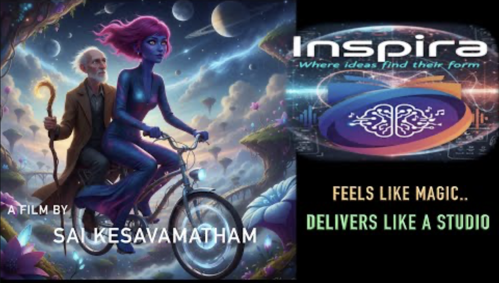
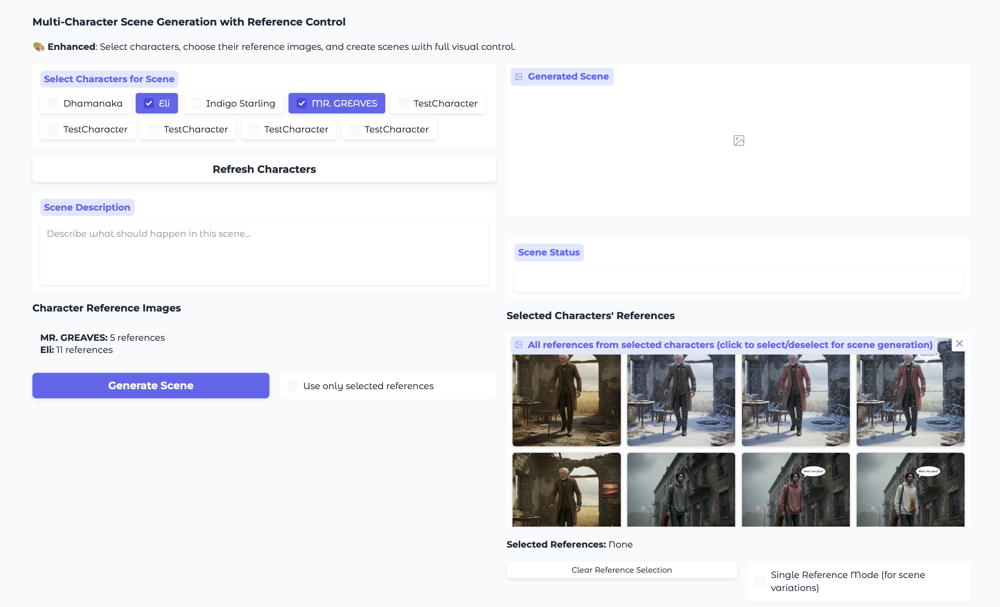
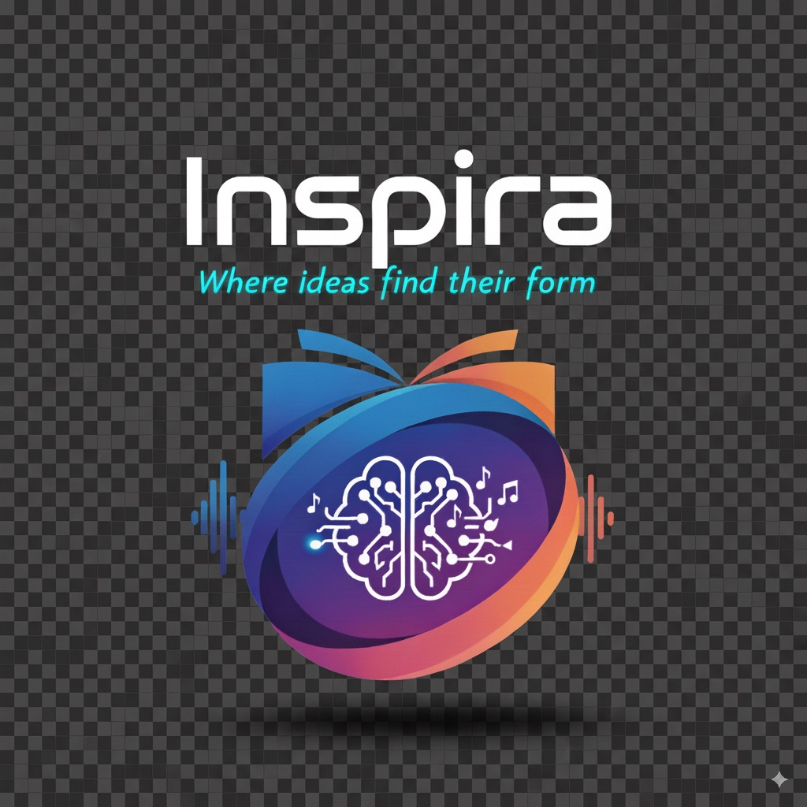
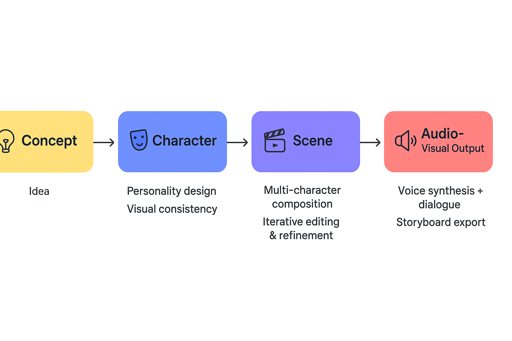

# 🍌 Inspira: Nano Banana Edition

### *Where Ideas Find Their Form.*

**Inspira** is a sovereign creative playground for storytellers, filmmakers, and world-builders. Born during the **Google DeepMind Nano Banana Hackathon (2025)**, this edition celebrates the raw, fluid synergy between **Google Gemini** and **ElevenLabs**.



---

## 🌟 The Vision

For centuries, the creative process followed a script, linear tax: you had an idea, and you spent years mastering complex tools to bring it to life. **Inspira** was built to break that friction. 

It treats AI not as an automated assembly line, but as a **Digital Chief of Staff**. Through iterative dialogue, your vision unfolds—preserving the "Visual DNA" of your world while evolving its mood, cadence, and voice.

---

## 🚀 Key Features (Nano Edition)

### 👥 Conversational World Building
*   **Dynamic Brainstorming**: Develop complex characters and deep lore through natural chat with Gemini.
*   **AI Scanning**: Automatically extract detailed character profiles from your creative sessions with one click.

### 🖼️ Context-Aware Storyboarding
*   **Gemini 2.5/3.1 Flash**: Leverage cutting-edge multi-image fusion for character consistency.
*   **Iterative Refining**: "Shift the key light to golden hour," or "Move the character closer to the lens"—refine visuals without losing the scene's structure.
*   **Character Anchors**: Keep your protagonist stable across multiple environments and emotional beats.

### 🎵 Multi-Sensory Synthesis
*   **ElevenLabs Integration**: Assign unique, high-fidelity voices to your cast.
*   **Synchronized Dialogue**: Generate scene audio that maps directly to your storyboard panels for instant "rough cuts."

---

## 🎨 Visual Journey

### 1. From Chat to Character
| Brainstorming | Scan & Extract | Character Profile |
| :--- | :--- | :--- |
|  | ➡️ |  |

### 2. Scene Development
*Iterative refinement allows you to evolve the mood while maintaining structural truth.*


---

## 📹 Video Walkthrough

Watch the walkthrough of Inspira in action:

**[Local video file](assets/logowithaudio.mov)** — download and play directly from the repo.

[](https://www.youtube.com/watch?v=09QUiF_x0us)

---

## 🧩 Sovereign & Expandable

This Nano Banana Edition is built on cloud APIs (Google Gemini + ElevenLabs) for simplicity and portability. It does **not** include local LLM, ComfyUI, or Qwen-TTS integrations — those are part of the separate private Pro version.

If you want to extend this edition locally, the pipeline is designed to be future-proof and can be expanded to include:

*   **Local LLMs**: Integration with Ollama for private, on-device brainstorming.
*   **Local Image Control**: Hooks for ComfyUI to maintain stable, local control over character features.
*   **Local Voice**: Support for zero-latency, on-device TTS models (like Qwen-TTS).

---

## 🛠️ Getting Started

### Prerequisites
*   Python 3.8 or higher
*   [Google Gemini API Key](https://aistudio.google.com/)
*   [ElevenLabs API Key](https://elevenlabs.io/) (Optional)

### Installation

1.  **Clone the Repository**
    ```bash
    git clone https://github.com/sai009/Inspira-nanobanana.git
    cd Inspira-nanobanana
    ```

2.  **Setup Environment**
    ```bash
    python3 -m venv venv
    source venv/bin/activate  # Windows: venv\Scripts\activate
    pip install -r requirements.txt
    ```

3.  **Run Inspira**
    ```bash
    python comprehensive_studio.py
    ```

---

## 📖 The Workflow

1.  **🔑 API Setup**: Configure your Gemini and ElevenLabs keys.
2.  **💬 Development**: Chat to build your world.
3.  **🔍 Identification**: Scan and save your characters.
4.  **🎨 Studio**: Create consistent reference images.
5.  **🎬 Storyboard**: Assemble scenes, generate panels, and layer in dialogue.

---

*Built with ❤️ for the AI Creative Community during the Google DeepMind Nano Banana Hackathon.*

---

## 👤 About the Author

**Sai Keshavamatham** (@sai009) — Fremont, California

Builder of self-training bipedal robots (Pollen Microduck, 25 cm, 15 motors) and creative AI tools. This project was created for the Google DeepMind Nano Banana Hackathon (2025), Special Technology Prize – ElevenLabs.

- **GitHub**: https://github.com/sai009
- **Kaggle**: https://www.kaggle.com/wavesandpixelsfilms

## 📄 License

Code: [MIT License](LICENSE)  
Writeup/essay: [CC BY 4.0](https://creativecommons.org/licenses/by/4.0/)

You are free to use, modify, and distribute the code with attribution. If you reuse the writeup or essay text, credit WavesAndPiXels Films per CC BY 4.0.
